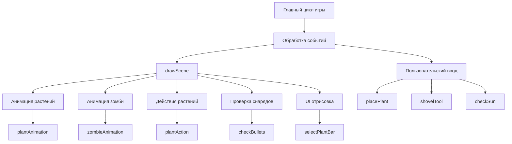
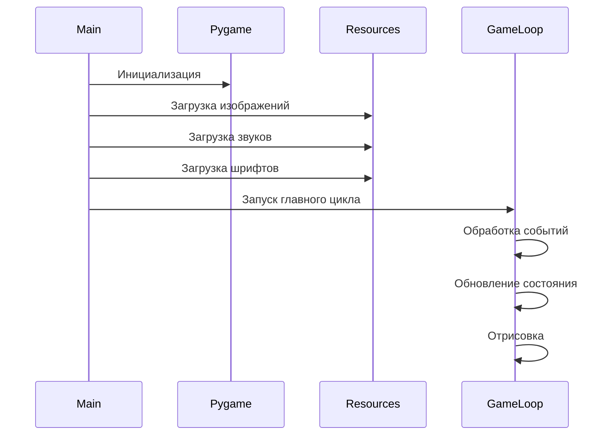

# Plants vs Zombies

## Описание игры

Plants vs Zombies, разработанный на Python с использованием библиотеки Pygame. Игра представляет собой стратегическую башенную защиту, где игрок должен защищать свой дом от наступающих зомби, размещая различные растения на поле.

### Как играть

1. **Цель игры**: Выжить как можно больше волн зомби, защищая свой дом
2. **Управление**: Только мышью
3. **Валюта**: Солнечная энергия (Sun), которая падает с неба или производится подсолнухами
4. **Механика**: Размещайте растения на поле 9x5 клеток для защиты от зомби

### Типы растений

- **Peashooter** - стреляет горохом
- **Sunflower** - производит солнечную энергию
- **Wall-nut** - высокое здоровье, блокирует зомби
- **Snow Pea** - стреляет замораживающими снарядами
- **Cherry Bomb** - взрывается, уничтожая всех зомби в радиусе
- **Potato Mine** - взрывается при контакте с зомби

### Инструменты

- **Лопата** - для удаления растений
- **Газонокосилки** - автоматически уничтожают всех зомби в ряду при активации

## 1. Структура проекта

```
plants-vs-zombies/
├── PlantsVsZombies.py    # Основной файл игры
├── fonts/
│   └── SeriesOrbit.TTF                  # Шрифт для UI
└── freezeAlpha.png                      # Текстура для эффектов
```

**Примечание**: Игра ссылается на ресурсы в папках `sprites/`, `sounds/`, `menu/`, `backgrounds/`, которые отсутствуют в текущей версии проекта.

## 2. Описание файлов

### `PlantsVsZombies - Phillip Pham.py` (1242 строки)

**Назначение**: Основной файл игры, содержащий всю логику и игровые механики

**Ключевые функции**:

#### Основные игровые функции:
- `drawScene()` - главная функция отрисовки и логики игры
- `zombieAnimation()` - анимация и движение зомби
- `plantAction()` - действия растений (стрельба, производство энергии)
- `checkBullets()` - проверка попаданий снарядов

#### UI функции:
- `selectPlantBar()` - отображение панели выбора растений
- `shovelTool()` - инструмент лопаты для удаления растений
- `blitLawnMower()` - отображение газонокосилок

#### Утилиты:
- `addSprites()` - загрузка спрайтов из папок
- `createGrid()` - создание 2D сетки для игрового поля
- `inList()` - поиск элемента в 2D списке
- `blit_alpha()` - отрисовка с прозрачностью

#### Игровые механики:
- `placePlant()` - размещение растений на поле
- `addZombies()` - добавление волн зомби
- `addSun()` - добавление солнечной энергии
- `checkSun()` - сбор солнечной энергии игроком

**Связи с другими файлами**:
- Загружает изображения из папок `sprites/`, `menu/`, `backgrounds/`
- Загружает звуки из папки `sounds/`
- Использует шрифт из `fonts/SeriesOrbit.TTF`

**Логика работы**:
1. Инициализация Pygame и загрузка ресурсов
2. Главный игровой цикл с обработкой событий
3. Отрисовка сцены через `drawScene()`
4. Обновление состояния игры (зомби, растения, снаряды)
5. Обработка пользовательского ввода

### `fonts/SeriesOrbit.TTF`

**Назначение**: Шрифт для отображения текста в игре
**Использование**: UI элементы, счетчики, сообщения

### `freezeAlpha.png`

**Назначение**: Текстура для эффектов прозрачности
**Использование**: Визуальные эффекты в игре

## 3. Архитектура проекта

### Общая структура



### Потоки данных

1. **Инициализация**:
   - Загрузка ресурсов (изображения, звуки, шрифты)
   - Создание игровых сеток и списков
   - Настройка таймеров

2. **Игровой цикл**:
   - Обработка событий Pygame
   - Обновление состояния игры
   - Отрисовка сцены
   - Управление FPS

3. **Управление состоянием**:
   - Списки зомби, растений, снарядов
   - Сетки для хранения данных о растениях
   - Таймеры для событий

### Архитектурные паттерны

- **Game Loop Pattern** - основной цикл игры
- **Component Pattern** - разделение логики на функции
- **State Management** - управление состоянием через списки и сетки

## 4. Библиотеки/фреймворки

### Pygame
- **Назначение**: Основная библиотека для создания 2D игр
- **Использование**:
  - Окно и отрисовка (`display`, `screen`)
  - Обработка событий (`event`)
  - Работа с изображениями (`image`)
  - Звук (`mixer`)
  - Шрифты (`font`)
  - Таймеры (`time`)

### Стандартные библиотеки Python
- **random** - генерация случайных чисел для зомби
- **math** - математические вычисления

## 5. Точка входа и запуск

### Запуск проекта

```bash
python "PlantsVsZombies - Phillip Pham.py"
```

### Что выполняется первым

1. **Импорт библиотек** (строки 15-17)
2. **Определение функций** (строки 23-668)
3. **Инициализация Pygame** (строки 838-840)
4. **Загрузка ресурсов** (строки 848-1038)
5. **Главный игровой цикл** (строки 1040+)

### Последовательность инициализации



## 6. Архитектурные особенности

### Нестандартные решения

1. **Единый файл архитектура**: Вся игра в одном файле для простоты
2. **Сеточная система**: Использование 2D сеток для хранения данных о растениях
3. **Списковое управление**: Все игровые объекты хранятся в списках
4. **Функциональное программирование**: Логика разделена на чистые функции

### Причины выбора архитектуры

1. **Простота**: Один файл легче понять и модифицировать
2. **Производительность**: Минимальные накладные расходы
3. **Образовательная ценность**: Понятная структура для изучения
4. **Совместимость**: Работает на любой системе с Python и Pygame

### Ограничения текущей архитектуры

1. **Масштабируемость**: Сложно добавлять новые функции
2. **Читаемость**: Большой файл сложно навигировать
3. **Тестируемость**: Сложно писать unit-тесты
4. **Переиспользование**: Код не модульный

### Рекомендации по улучшению

1. **Модульная архитектура**: Разделить на отдельные файлы
2. **Классовая структура**: Использовать ООП для игровых объектов
3. **Конфигурационные файлы**: Вынести настройки в отдельные файлы
4. **Система ресурсов**: Централизованное управление ресурсами

## Технические характеристики

- **Язык программирования**: Python
- **Игровой движок**: Pygame
- **Разрешение**: 1200x800 пикселей
- **FPS**: 30 кадров в секунду
- **Игровое поле**: 9x5 клеток
- **Размер клетки**: 120x130 пикселей

## Требования для запуска

- Python 3.x
- Pygame
- Файлы ресурсов (изображения, звуки, шрифты)

Подпись относится к текущей версии проекта.

---

Автор: legenda  
Telegram: [@LEGENDA_SD](https://t.me/LEGENDA_SD)
